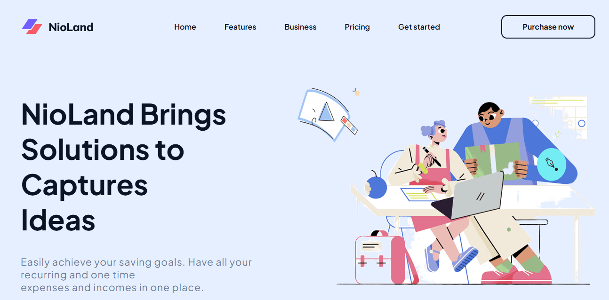

# NioLand – Responsive SaaS Landing Page

A modern, multi-section landing page for a fictional SaaS product, built with **pure HTML5 and CSS3** (no framework, no JavaScript).
This is the second project of my web development training, following my first [HTML & CSS project](https://github.com/mouadh12-code/html-css-project).



## Live demo

**👉 https://visionary-crumble-860b03.netlify.app**

## Sections

| Section | What it contains |
|---|---|
| **Header** | Logo, navigation menu, "Purchase now" button with hover effect |
| **Hero** | Headline, description, two call-to-action buttons, illustration |
| **Features** | Three feature cards (Custom Analytics, Team Management, Measure Performance) |
| **Business** | Three alternating "How to grow your business" blocks with color-coded steps |
| **Pricing** | Comparison table with four plans (Intro, Base, Pro, Enterprise) |
| **Footer** | Brand description, three link columns, copyright |

## What I practiced

- Semantic HTML5 structure (`header`, `section`, `footer`, `table`)
- **Flexbox** for the navbar and text alignment
- **CSS Grid** for the hero, feature cards, business blocks and footer
- Custom design system with a consistent color palette and reusable button classes (`.btn-blue`, `.btn-outline-blue`, `.btn-outline-orange`, `.btn-outline-red`)
- Hover states and smooth `transition` animations
- Custom typography with Google Fonts (Plus Jakarta Sans)
- Translating a visual design into clean, organized code

## Tech stack


## Project structure

```
landing-page-project/
├── index.html      # Page structure and content
├── style.css       # All styles
├── assets/         # Logo, illustrations, store badges
└── images/         # README screenshot
```

## Run locally

```bash
git clone https://github.com/mouadh12-code/landing-page-project.git
cd landing-page-project
```

Then open `index.html` in your browser. No build step or dependencies needed.

## Roadmap

- [ ] Make the layout fully responsive (media queries for tablet and mobile)
- [ ] Add a working mobile navigation menu with JavaScript
- [ ] Improve accessibility (focus states, contrast)

## Author

**Mouadh Laajili**, final-year software engineering student at ESPRIT, looking for a PFE internship starting January 2027.

- GitHub: [@mouadh12-code](https://github.com/mouadh12-code)
- LinkedIn: [Mouadh Laajili](https://www.linkedin.com/in/mouadh-laajili)

## Acknowledgments

Design inspiration and assets come from the training course. This project is for learning purposes only.
